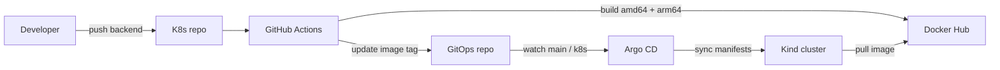

# Argo CD + GitHub Actions GitOps Example

An end-to-end GitOps example that shows how a code change in this repository becomes a running Deployment in a local Kind cluster:

- The `K8s` repository builds an Express backend image.
- GitHub Actions pushes a multi-arch image to Docker Hub.
- The workflow updates the image tag in a separate `GitOps` repository.
- Argo CD watches the `GitOps` repository and deploys the result.

## What's in this folder

```text
basics/argocd/
├── README.md                  # this guide
├── argocd-application.yaml    # Argo CD Application (bootstrap)
└── backend/
    ├── .dockerignore
    ├── Dockerfile
    ├── index.js
    └── package.json
```

Related files elsewhere in this repository:

- `.github/workflows/argocd-backend-ci.yml` — the CI pipeline.
- `basics/kind-config.yaml` — the local cluster config.

The deployment manifests live in the separate GitOps repository (`https://github.com/24thAbhinav/GitOps`), not here.

## What gets deployed

| Component | Value |
| --- | --- |
| Backend | Express app, `GET /` returns `{"health":"OK"}`, listens on port `3000` |
| Image | `abhinavchauhan24/argocd-backend:<short-sha>` |
| Deployment | `argocd-backend-deployment`, 4 replicas |
| Service | `argocd-backend-service`, `ClusterIP`, port `3000` |
| CI workflow | `.github/workflows/argocd-backend-ci.yml` |
| GitOps repository | `https://github.com/24thAbhinav/GitOps`, path `k8s/`, branch `main` |
| Argo CD Application | `learning-argocd` in namespace `argocd` |
| Target namespace | `default` |
| Local cluster | Kind cluster `argo-cluster` |
| Argo CD version verified | `v3.5.6` |

The backend is intentionally tiny. The point is the delivery path, not the application.

## Architecture



## How the flow works

1. A change lands under `basics/argocd/backend/` on `main`, or the workflow is manually dispatched.
2. GitHub Actions builds the Docker image for `linux/amd64` and `linux/arm64`.
3. The image is pushed as `abhinavchauhan24/argocd-backend:<short-sha>`.
4. The workflow checks out the `GitOps` repository and replaces the image tag in `k8s/deployment.yaml`.
5. The workflow commits and pushes that one-line change to `GitOps` `main`.
6. Argo CD detects the new commit and syncs the Deployment and Service.
7. Kubernetes performs a rolling update and pulls the new image.

The GitOps repository has no workflows. This avoids a recursive build loop: a CI commit there does not trigger another image build.

## Part 1: Run the backend locally

```bash
cd basics/argocd/backend
npm install
node index.js
```

In another terminal:

```bash
curl http://localhost:3000/
```

Expected:

```json
{"health":"OK"}
```

The app is a small Express 5 service with a single `/` route. It logs `Express Server running on PORT 3000` on startup.

## Part 2: Build and test the image

The Docker build context is `basics/argocd/backend`, not the repository root:

```bash
docker build -t abhinavchauhan24/argocd-backend:local basics/argocd/backend
docker run --rm -p 3000:3000 abhinavchauhan24/argocd-backend:local
```

Then:

```bash
curl http://localhost:3000/
```

The Dockerfile uses `node:20-alpine`, installs production dependencies, copies `index.js`, exposes `3000`, and starts the app with `node index.js`.

The [`.dockerignore`](backend/.dockerignore) keeps `node_modules`, local environment files, logs, and Git metadata out of the build context.

Manual pushes are for debugging. The normal path is the CI workflow:

```bash
docker login
docker tag abhinavchauhan24/argocd-backend:local abhinavchauhan24/argocd-backend:<short-sha>
docker push abhinavchauhan24/argocd-backend:<short-sha>
```

Use your own Docker Hub username and repository if you are not reproducing the existing example.

## Part 3: Prepare the GitOps repository

The GitOps repository is already populated in the reference setup. To reproduce it from scratch:

```bash
git clone https://github.com/24thAbhinav/GitOps.git
cd GitOps
mkdir -p k8s
```

Create `k8s/deployment.yaml`:

```yaml
apiVersion: apps/v1
kind: Deployment
metadata:
  name: argocd-backend-deployment
spec:
  replicas: 4
  selector:
    matchLabels:
      app: argocd-backend
  template:
    metadata:
      labels:
        app: argocd-backend
    spec:
      containers:
        - name: argocd-backend
          image: abhinavchauhan24/argocd-backend:<short-sha>
          ports:
            - containerPort: 3000
```

Replace `<short-sha>` with an image tag that already exists in Docker Hub. If you are bootstrapping before the first CI run, either use the current tag in the existing GitOps repo or trigger CI first, wait for the image push, and then update the tag.

Create `k8s/service.yaml`:

```yaml
apiVersion: v1
kind: Service
metadata:
  name: argocd-backend-service
spec:
  selector:
    app: argocd-backend
  ports:
    - protocol: TCP
      port: 3000
      targetPort: 3000
  type: ClusterIP
```

Commit and push:

```bash
git add k8s/deployment.yaml k8s/service.yaml
git commit -m "feat: add argocd backend manifests"
git push origin main
```

The full GitOps guide, including rollback and troubleshooting, is in the [GitOps README](https://github.com/24thAbhinav/GitOps/blob/main/README.md).

## Part 4: Create tokens and GitHub Actions secrets

> [!WARNING]
> Use a **30-day expiry** for the GitHub fine-grained PAT and the Docker Hub access token. When either expires, CI fails. Set a reminder for day 25 and rotate before day 30.

The workflow needs three secrets in the `K8s` repository, not in `GitOps`:

| Secret | Value | Scope | Expiry |
| --- | --- | --- | --- |
| `DOCKERHUB_USERNAME` | Docker Hub username | Your account | Not applicable |
| `DOCKERHUB_TOKEN` | Docker Hub access token | Read & Write for the image repository | 30 days |
| `GITOPS_TOKEN` | GitHub fine-grained PAT | Only `24thAbhinav/GitOps`, Contents: Read and write | 30 days |

`GITHUB_TOKEN` is provided automatically, but it cannot push to a different repository with the permissions this workflow needs. That is why `GITOPS_TOKEN` exists.

### Docker Hub token

1. Sign in to Docker Hub.
2. Open **Account settings** -> **Security** -> **New access token**.
3. Name it something like `k8s-gitops-ci`.
4. Choose **Read & Write**.
5. Set a 30-day expiry.
6. Copy the token once. It is not shown again.
7. Create a public repository named `argocd-backend` if it does not exist.

### GitHub fine-grained PAT

1. Open GitHub **Settings** -> **Developer settings** -> **Personal access tokens** -> **Fine-grained tokens**.
2. Click **Generate new token**.
3. Set an expiration of **30 days**.
4. Under **Repository access**, choose **Only select repositories** and select `24thAbhinav/GitOps`.
5. Under **Permissions** -> **Repository permissions**, set **Contents** to **Read and write**.
6. Generate and copy the token once.

### Add the secrets

With the GitHub CLI (you need admin access to the repository, and `gh auth login` must be configured):

```bash
gh secret set DOCKERHUB_USERNAME --repo 24thAbhinav/K8s
gh secret set DOCKERHUB_TOKEN --repo 24thAbhinav/K8s
gh secret set GITOPS_TOKEN --repo 24thAbhinav/K8s
```

Each command prompts for the value, so the secret is not written to shell history. Verify the names:

```bash
gh secret list --repo 24thAbhinav/K8s
```

The values are never displayed. Alternatively, use **Settings** -> **Secrets and variables** -> **Actions** -> **New repository secret** in the GitHub UI.

## Part 5: Trigger the first CI run

A change under `basics/argocd/backend/` on `main` triggers the workflow:

```bash
git add basics/argocd/backend
git commit -m "feat: update argocd backend"
git push origin main
```

If there is no backend change, dispatch it manually:

```bash
gh workflow run argocd-backend-ci.yml \
  --repo 24thAbhinav/K8s \
  --ref main

gh run list \
  --repo 24thAbhinav/K8s \
  --workflow=argocd-backend-ci.yml \
  --limit 5
```

Watch the newest run:

```bash
gh run watch --repo 24thAbhinav/K8s
```

Expected successful steps:

1. Checkout the `K8s` repository.
2. Compute a 7-character short SHA.
3. Set up QEMU and Buildx.
4. Log in to Docker Hub.
5. Build and push `linux/amd64,linux/arm64`.
6. Checkout `GitOps` using `GITOPS_TOKEN`.
7. Replace the image tag in `k8s/deployment.yaml`.
8. Commit and push to `GitOps` `main`.

Check the new image and the GitOps commit:

```bash
docker buildx imagetools inspect abhinavchauhan24/argocd-backend:<short-sha>

git clone https://github.com/24thAbhinav/GitOps.git /tmp/GitOps 2>/dev/null || git -C /tmp/GitOps pull --ff-only
git -C /tmp/GitOps log --oneline -3
grep image: /tmp/GitOps/k8s/deployment.yaml
```

The image tag should match the short SHA of the `K8s` commit that triggered the run.

## Part 6: Install Argo CD and create the Application

### Install Argo CD

```bash
kubectl create namespace argocd --dry-run=client -o yaml | kubectl apply -f -
kubectl apply -n argocd -f https://raw.githubusercontent.com/argoproj/argo-cd/v3.5.6/manifests/install.yaml
kubectl -n argocd rollout status deployment/argocd-server
```

The manifest is pinned to the version verified for this example. Using Argo CD `stable` also works but may install a newer release.

### Open the UI

```bash
kubectl -n argocd port-forward svc/argocd-server 8080:443
```

Open `https://localhost:8080`. The username is `admin`. Get the initial password:

```bash
kubectl -n argocd get secret argocd-initial-admin-secret \
  -o jsonpath='{.data.password}' | base64 -d
echo
```

The certificate is self-signed, so the browser warning is expected locally. Change the admin password after the first login.

### Apply the Argo CD Application

The bootstrap manifest is [`argocd-application.yaml`](argocd-application.yaml):

```yaml
apiVersion: argoproj.io/v1alpha1
kind: Application
metadata:
  name: learning-argocd
  namespace: argocd
spec:
  project: default
  source:
    repoURL: https://github.com/24thAbhinav/GitOps.git
    targetRevision: main
    path: k8s
  destination:
    server: https://kubernetes.default.svc
    namespace: default
  syncPolicy:
    automated:
      enabled: true
      prune: false
      selfHeal: true
```

Apply it from the repository root:

```bash
kubectl apply -f basics/argocd/argocd-application.yaml
```

If the Application already exists but points at the wrong source, patch it instead of deleting and recreating it:

```bash
kubectl -n argocd patch application learning-argocd --type=merge \
  -p '{"spec":{"source":{"repoURL":"https://github.com/24thAbhinav/GitOps.git","path":"k8s","targetRevision":"main"}}}'
```

The critical field is `path: k8s`. If it points at `.`, Argo CD reads the repository root and may report `Synced` while managing no resources.

The image tag must exist before the Pods can start. If the tag is missing, Pods stay in `ImagePullBackOff` until CI pushes it.

### Understand the sync policy

- `automated.enabled: true` turns automated sync on.
- `prune: false` means deleting a manifest from GitOps does not automatically delete the live object. Delete it manually, or enable pruning deliberately.
- `selfHeal: true` reverts manual `kubectl` edits to the Git state. Make changes in Git if you want them to persist.

## Part 7: Verify the deployment

```bash
kubectl -n argocd get application learning-argocd
kubectl -n argocd get application learning-argocd \
  -o jsonpath='{.status.sync.status}{" / "}{.status.health.status}{"\n"}'
kubectl -n argocd get application learning-argocd \
  -o jsonpath='{range .status.resources[*]}{.kind}/{.name}{"\n"}{end}'
```

Expected:

```text
NAME              SYNC STATUS   HEALTH STATUS
learning-argocd   Synced        Healthy
```

The managed resources should include:

```text
Service/argocd-backend-service
Deployment/argocd-backend-deployment
```

Check the workload:

```bash
kubectl get deployment argocd-backend-deployment
kubectl get pods -l app=argocd-backend
kubectl get service argocd-backend-service
kubectl get deployment argocd-backend-deployment \
  -o jsonpath='{.spec.template.spec.containers[0].image}{"\n"}'
```

Expected: the Deployment is `4/4`, four Pods are `Running`/`Ready`, and the image tag matches the tag written by the latest GitOps commit.

Test the HTTP endpoint. The Service is `ClusterIP`, so use a port-forward:

```bash
kubectl port-forward service/argocd-backend-service 3000:3000
```

In another terminal:

```bash
curl http://localhost:3000/
```

Expected:

```json
{"health":"OK"}
```

## Part 8: Make a change and watch it deploy

Make a harmless backend change, for example add a log line to `basics/argocd/backend/index.js`, then commit and push:

```bash
git add basics/argocd/backend/index.js
git commit -m "feat: update argocd backend"
git push origin main
```

Watch the workflow:

```bash
gh run watch --repo 24thAbhinav/K8s
```

Watch the rollout:

```bash
kubectl rollout status deployment/argocd-backend-deployment
```

Confirm the new image tag:

```bash
kubectl get deployment argocd-backend-deployment \
  -o jsonpath='{.spec.template.spec.containers[0].image}{"\n"}'
```

Argo CD polls the GitOps repository about every three minutes by default. Force a refresh if needed:

```bash
kubectl -n argocd annotate application learning-argocd \
  argocd.argoproj.io/refresh=normal --overwrite
```

## How the CI workflow works

The workflow is `.github/workflows/argocd-backend-ci.yml`.

### Trigger

```yaml
on:
  push:
    branches:
      - main
    paths:
      - basics/argocd/backend/**
  workflow_dispatch:
```

- A backend change on `main` triggers it.
- A README-only or GitOps-only change does not.
- `workflow_dispatch` allows a rebuild after a secret rotation or a transient failure.

### Permissions and concurrency

```yaml
permissions:
  contents: read

concurrency:
  group: argocd-backend-ci-${{ github.ref }}
  cancel-in-progress: false
```

The workflow only needs read access to the `K8s` repository. The cross-repository push uses `GITOPS_TOKEN`. Runs are queued rather than canceled, so a production image is not skipped.

### Build and push

```yaml
- uses: docker/setup-qemu-action@v3
- uses: docker/setup-buildx-action@v3
- uses: docker/login-action@v3
  with:
    username: ${{ secrets.DOCKERHUB_USERNAME }}
    password: ${{ secrets.DOCKERHUB_TOKEN }}
- uses: docker/build-push-action@v6
  with:
    context: basics/argocd/backend
    file: basics/argocd/backend/Dockerfile
    platforms: linux/amd64,linux/arm64
    push: true
    tags: ${{ env.IMAGE_NAME }}:${{ steps.vars.outputs.short_sha }}
```

QEMU is required because the GitHub runner is `amd64` and the Kind cluster on Apple Silicon is `arm64`. The image is built for both architectures so it runs on either.

### Update GitOps

```bash
sed -i -E "s|image: ${IMAGE_NAME}:[^[:space:]]+|image: ${IMAGE_NAME}:${SHORT_SHA}|" "${GITOPS_MANIFEST}"
```

The workflow then checks whether `k8s/deployment.yaml` actually changed. If the tag is already current, it exits successfully without an empty commit. Otherwise it commits as `github-actions[bot]` and pushes to `GitOps` `main`.

The workflow updates only the image line. Replica count, Service settings, labels, and every other field remain under human control.

## Why the image is multi-arch

Kind nodes inherit the host architecture. On an Apple Silicon Mac, the nodes are `arm64`. A GitHub runner normally builds `amd64` images. An `amd64`-only image on an `arm64` node produces:

```text
ImagePullBackOff
no match for platform in manifest
```

The fix is QEMU plus `platforms: linux/amd64,linux/arm64`, which this workflow does. Verify an image with:

```bash
docker buildx imagetools inspect abhinavchauhan24/argocd-backend:<short-sha>
```

If you remove QEMU or the `platforms` line, the failure can return.

## Token expiry and rotation

### Why 30 days

Both the GitHub PAT and the Docker Hub token are credentials that can push code or images. A 30-day expiry limits the blast radius if one leaks. The tradeoff is that CI will break on day 30 unless you rotate.

### Rotation checklist

- Day 0: create both tokens with a 30-day expiry.
- Day 25: create replacements and update the GitHub Actions secrets.
- Day 30: revoke the old tokens if they are still listed.
- Re-run the workflow once to prove the new credentials work.
- If a token is exposed, revoke it immediately. Do not wait for the expiry date.

### Symptoms

| Failure point | Symptom | Cause |
| --- | --- | --- |
| Docker login | `Username and password required`, `unauthorized` | Missing, revoked, or expired Docker Hub token |
| Docker push | `denied` | Token lacks write permission or targets the wrong repository |
| GitOps push | `403`, `Permission to 24thAbhinav/GitOps.git denied` | PAT lacks Contents: Read and write, expired, or wrong repository |
| GitOps checkout | `could not read Username` | Missing or invalid `GITOPS_TOKEN` |

Update a secret without exposing it in shell history:

```bash
gh secret set GITOPS_TOKEN --repo 24thAbhinav/K8s
gh secret set DOCKERHUB_TOKEN --repo 24thAbhinav/K8s
```

Then dispatch the workflow:

```bash
gh workflow run argocd-backend-ci.yml --repo 24thAbhinav/K8s --ref main
```

## Using your own accounts

The reference setup uses these names:

- Application repository: `24thAbhinav/K8s`
- GitOps repository: `24thAbhinav/GitOps`
- Docker Hub image: `abhinavchauhan24/argocd-backend`

If you fork or copy the setup, update all of these together:

1. `.github/workflows/argocd-backend-ci.yml`: `IMAGE_NAME`, `GITOPS_REPO`, `GITOPS_BRANCH`, `GITOPS_MANIFEST`.
2. `basics/argocd/argocd-application.yaml`: `spec.source.repoURL`.
3. `GitOps/k8s/deployment.yaml`: the initial image name.
4. Docker Hub: create the image repository.
5. GitHub Actions secrets: `DOCKERHUB_USERNAME`, `DOCKERHUB_TOKEN`, `GITOPS_TOKEN`.

If the GitOps repository is private, Argo CD needs its own repository credentials. The CI PAT is for GitHub Actions, not for the Argo CD controller. Do not reuse it if you can avoid it.

If the Docker Hub repository is private, create a `docker-registry` Secret in the `default` namespace and add `imagePullSecrets` to the Deployment. The CI push token is not automatically available to the kubelet.

## Day-2 operations

### Deploy a new version

Push a change under `basics/argocd/backend/` on `main`. The workflow builds, pushes, and updates GitOps. Argo CD syncs.

### Roll back

Find a previous tag:

```bash
git -C /tmp/GitOps log --oneline -- k8s/deployment.yaml
```

Edit `k8s/deployment.yaml` to the known-good tag, then commit and push:

```bash
cd /tmp/GitOps
# edit image: abhinavchauhan24/argocd-backend:<previous-short-sha>
git add k8s/deployment.yaml
git commit -m "revert: roll argocd backend back to <previous-short-sha>"
git push origin main
```

Argo CD normally notices within about three minutes. Force a refresh:

```bash
kubectl -n argocd annotate application learning-argocd \
  argocd.argoproj.io/refresh=normal --overwrite
```

`argocd app rollback` can change the live state temporarily, but with `selfHeal: true` it is not durable. Update Git as well if you want the rollback to persist.

### Scale

Edit `spec.replicas` in `GitOps/k8s/deployment.yaml`, commit, and push.

### Restart Pods without changing the spec

```bash
kubectl delete pod -l app=argocd-backend
```

The Deployment recreates them. Avoid `kubectl rollout restart` here: it adds an annotation that is not in Git, so Argo CD may immediately reconcile the Deployment back and cause another rollout.

### Inspect logs and shell

```bash
kubectl logs deployment/argocd-backend-deployment --tail=100
kubectl exec -it deployment/argocd-backend-deployment -- sh
```

### Pause automated sync while debugging

```bash
kubectl -n argocd patch application learning-argocd --type=merge \
  -p '{"spec":{"syncPolicy":{"automated":null}}}'
```

Re-enable it:

```bash
kubectl -n argocd patch application learning-argocd --type=merge \
  -p '{"spec":{"syncPolicy":{"automated":{"enabled":true,"prune":false,"selfHeal":true}}}}'
```

### Clean up

```bash
kubectl delete -f basics/argocd/argocd-application.yaml
kubectl delete -f https://raw.githubusercontent.com/24thAbhinav/GitOps/main/k8s/deployment.yaml
kubectl delete -f https://raw.githubusercontent.com/24thAbhinav/GitOps/main/k8s/service.yaml

kubectl delete -n argocd -f https://raw.githubusercontent.com/argoproj/argo-cd/v3.5.6/manifests/install.yaml
kubectl delete namespace argocd

kind delete cluster --name argo-cluster
```

Because the Application uses `prune: false`, deleting the Application does not delete the live Deployment or Service. The explicit delete commands remove them.

## Troubleshooting

| Symptom | Likely cause | Fix |
| --- | --- | --- |
| `Username and password required` during Docker login | `DOCKERHUB_USERNAME` or `DOCKERHUB_TOKEN` is missing | Add both repository secrets |
| `unauthorized` or `denied` during Docker push | Token expired, revoked, or lacks write scope | Rotate the Docker Hub token and update the secret |
| `403` or `Permission to 24thAbhinav/GitOps.git denied` | `GITOPS_TOKEN` lacks Contents: Read and write, expired, or scoped to another repo | Rotate the PAT, update the secret, re-run |
| `ImagePullBackOff` with `no match for platform in manifest` | Image is `amd64` only, node is `arm64` | Keep QEMU and `platforms: linux/amd64,linux/arm64` |
| `ImagePullBackOff` with `manifest unknown` | The tag in `deployment.yaml` is not in Docker Hub | Trigger CI or point at an existing tag |
| `ImagePullBackOff` with `unauthorized` | Private Docker Hub repo without a pull secret | Create a `docker-registry` Secret and add `imagePullSecrets` |
| Application is `Synced` but no Deployment or Service is listed | `path` is `.` instead of `k8s` | Patch the Application source path |
| Application is `OutOfSync` after a manual `kubectl` edit | `selfHeal` is reverting the cluster to Git | Commit the change in GitOps, or pause auto-sync while debugging |
| Pods are `Pending` | No schedulable node or insufficient resources | `kubectl describe pod` and `kubectl describe node` |
| Pods are `CrashLoopBackOff` | Application error | `kubectl logs deployment/argocd-backend-deployment` |
| Service does not answer from the host | `ClusterIP` is cluster-internal | Use `kubectl port-forward` or add an Ingress |
| Argo CD cannot read the GitOps repo | Private repo without Argo CD repository credentials | Add credentials in the `argocd` namespace |
| Workflow does not run after a README change | Path filter only matches `basics/argocd/backend/**` | Expected; use `workflow_dispatch` |
| Workflow fails with `non-fast-forward` | Another push landed in GitOps first | Re-run the workflow, or pull/rebase and push |
| Workflow says there is nothing to commit | The image tag already matches the short SHA | Expected for an idempotent run |

### Force Argo CD to refresh

```bash
kubectl -n argocd annotate application learning-argocd \
  argocd.argoproj.io/refresh=normal --overwrite
```

With the CLI:

```bash
argocd app get learning-argocd --refresh
argocd app sync learning-argocd
```

### Confirm the Application manages the expected resources

```bash
kubectl -n argocd get application learning-argocd \
  -o jsonpath='{range .status.resources[*]}{.kind}/{.name}{"\n"}{end}'
```

Expected:

```text
Service/argocd-backend-service
Deployment/argocd-backend-deployment
```

### Confirm the image architecture

```bash
docker buildx imagetools inspect abhinavchauhan24/argocd-backend:<short-sha>
```

The output should include both `linux/amd64` and `linux/arm64`.

## Security checklist

- Never commit tokens, passwords, kubeconfigs, private keys, or real `.env` values.
- Use a dedicated Docker Hub access token, not your account password.
- Give `GITOPS_TOKEN` the smallest scope that works: one repository, Contents read/write.
- Keep both tokens on a 30-day expiry and rotate before they lapse.
- Revoke a token immediately if it is exposed.
- Do not reuse the CI PAT for Argo CD repository access. Use a separate credential if the GitOps repository becomes private.
- The Docker Hub token is for push. A private cluster needs a separate pull secret.
- Use immutable SHA tags. Avoid `latest`.
- Review GitOps changes before merge. That repository is the deployment source of truth.
- Keep `prune: false` unless you fully understand which objects Argo CD may delete.
- If `main` is protected, allow the workflow identity to bypass the rule or use a pull-request-based GitOps flow.
- Fork pull requests do not receive repository secrets by default. The workflow runs on `push` to `main`, not on untrusted PRs.
- Change the Argo CD admin password after first login.

## Production hardening

This example is deliberately small. Before using the pattern for real workloads, add:

- Automated tests and linting in CI; the current workflow only builds and pushes.
- A committed lockfile and `npm ci --omit=dev` for reproducible installs.
- Resource requests and limits, readiness and liveness probes, and a PodDisruptionBudget.
- An Ingress with TLS, or a `LoadBalancer` Service, instead of only `ClusterIP`.
- Sealed Secrets, External Secrets, or a cloud secret manager instead of plaintext Secret manifests.
- Image scanning, signing, and deployment by digest.
- Kustomize or Helm overlays for multiple environments.
- A PR-based GitOps flow with branch protection, review, and audit history.
- Monitoring, alerting, and log aggregation.
- NetworkPolicies and a least-privilege service account.

## Further reading

- [Argo CD documentation](https://argo-cd.readthedocs.io/)
- [Argo CD Application specification](https://argo-cd.readthedocs.io/en/stable/user-guide/application-specification/)
- [GitHub Actions documentation](https://docs.github.com/en/actions)
- [Docker build-push-action](https://github.com/docker/build-push-action)
- [Kind documentation](https://kind.sigs.k8s.io/)
- [GitOps repository](https://github.com/24thAbhinav/GitOps)
- [Repository root README](../../README.md)

---

This example targets a local learning environment. Review and harden it before using it with real traffic, real data, or real credentials.
