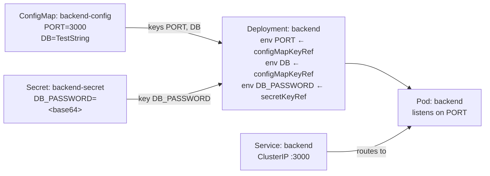

# ConfigMap + Secret → PORT (Express backend)

A tiny example showing how a **ConfigMap** and a **Secret** feed values into a Pod. The ConfigMap holds `PORT` and `DB`, the Secret holds `DB_PASSWORD`, the Deployment imports them as env vars, and the Express backend reads `process.env.PORT` and listens on it.



## Files

| File / Folder                       | Purpose                                                        |
| ----------------------------------- | -------------------------------------------------------------- |
| `configmap.yaml`                    | ConfigMap `backend-config` with `PORT: "3000"` and `DB`        |
| `secret.yaml`                       | Secret `backend-secret` with base64 `DB_PASSWORD`              |
| `.env`                              | Sample env file (fake values) — the source encoded into `secret-env.yaml` |
| `secret-env.yaml`                   | Secret `backend-env` holding the base64 of the whole `.env`    |
| `backend/server.js`                 | Express app — reads `PORT`, loads `.env`, listens on it        |
| `backend/{package.json,Dockerfile}` | Backend image (`node:20-alpine`)                               |
| `backend.yaml`                      | Deployment — imports ConfigMap/Secret keys and mounts the `.env` Secret as a file |
| `service.yaml`                      | ClusterIP Service on port 3000                                 |

## Run

```bash
cd basics/configmap-secret-port

# 1. Build + load the image
npm --prefix backend install
docker build -t configmap-port-backend:3.0 backend
kind load docker-image configmap-port-backend:3.0 --name my-cluster

# 2. Create the ConfigMaps + Secrets, then the Deployment and Service
kubectl apply -f configmap.yaml
kubectl apply -f secret.yaml
kubectl apply -f secret-env.yaml
kubectl apply -f backend.yaml
kubectl apply -f service.yaml

# 3. Wait until it is ready
kubectl get pods -l app=backend -w

# 4. Reach it
kubectl port-forward svc/backend 8080:3000
```

Then open <http://localhost:8080> — it prints the port the backend is listening on. <http://localhost:8080/port> returns it as JSON.

## Verify PORT came from the ConfigMap

```bash
kubectl logs -l app=backend
# PORT = 3000 (imported from the backend-config ConfigMap)
# DB = TestString (imported from the backend-config ConfigMap)
# DB_PASSWORD = s*** (len 14) (imported from the backend-secret Secret)
# listening on port 3000

kubectl describe configmap backend-config
# Data
# ====
# PORT:  3000
# DB:    TestString
```

## Verify DB_PASSWORD came from the Secret

```bash
kubectl get secret backend-secret -o jsonpath='{.data.DB_PASSWORD}' | base64 -d
# s3cr3t-db-p@ss
```

Note that `kubectl describe secret` shows only the key names and byte sizes, never the values — `describe configmap` prints values, `describe secret` does not.

## Mount a `.env` file as a Secret volume

Instead of one env var per key, you can put a whole `.env` file in a Secret and **mount it as a file** the app reads at startup.

```bash
# 1. Encode the .env file's contents
base64 -i .env        # macOS; use `cat .env | base64` on Linux
```

That base64 goes into `secret-env.yaml` under `data` with the key `.env`. The Deployment mounts that key as a read-only file at `/app/.env` (mounted with `subPath` so it does not shadow the rest of the app directory), and `server.js` loads it with `dotenv`.

```bash
kubectl exec deploy/backend -- cat /app/.env
# APP_MODE=development
# LOG_LEVEL=debug
# API_KEY=dev-api-key-123456

kubectl logs -l app=backend | grep -E 'APP_MODE|API_KEY'
# APP_MODE = development, LOG_LEVEL = debug (loaded from .env)
# API_KEY = d*** (len 18) (loaded from .env)
```

Go inside the Pod and check the file is mounted where you expect:

```bash
# Get the Pod name (or just use the deployment, e.g. deploy/backend)
kubectl get pods -l app=backend

kubectl exec -it <pod-name> -- sh
# inside the container:
ls -la /app        # .env should sit alongside server.js and node_modules
cat /app/.env      # the mounted Secret contents
exit
```

- **Mounting a file vs. `envFrom`:** a volume **mounts the `.env` file** for the app to read; `envFrom.secretRef` **injects keys as env vars** (the `.env` key would become an env var literally named `.env`).
- **Prefer not to base64 by hand?** `kubectl create secret generic backend-env --from-env-file=.env` splits it into one key per variable; `--from-file=.env` stores it as a single `.env` key (the equivalent of `secret-env.yaml`).

### `subPath`, shadowing, and refreshing

- **A mount replaces the directory it lands on.** The image's `WORKDIR` is `/app` and it holds `server.js`/`node_modules`. Mounting the Secret at `/app` would swap the *whole* directory for the volume — the app would vanish. `subPath: .env` places just the one file at `/app/.env` and leaves the rest of `/app` intact. To mount the whole Secret instead, use its own fresh directory (e.g. `/etc/backend-env`).
- **Plain mount refreshes; `subPath` does not.** A Secret mounted as a directory (`/etc/backend-env`) is re-synced by the kubelet, so editing the Secret rewrites the file in place within ~1 minute — no restart. A `subPath` file (`/app/.env`) is fixed at container start and never refreshes.
- **Env vars never refresh.** Values imported with `valueFrom.configMapKeyRef` / `valueFrom.secretKeyRef` (`PORT`, `DB`, `DB_PASSWORD`) are set once at container start and are not updated by a Secret/ConfigMap change.
- **This app reads the file once anyway.** `server.js` calls `dotenv` at startup, so even a refreshing mount wouldn't be picked up by the running process. Change a Secret/ConfigMap and restart:

  ```bash
  kubectl rollout restart deployment/backend
  ```

## Change the port

Edit `PORT` in the ConfigMap, re-apply, and restart the Pod (env vars are only read at container start):

```bash
kubectl patch configmap backend-config --type merge -p '{"data":{"PORT":"4000"}}'
kubectl rollout restart deployment/backend
```

If you change `PORT`, also update the Service `targetPort` (and the Deployment `containerPort`) to the same number, otherwise the Service points at the wrong port.

## Notes

- **One key vs. all keys:** `valueFrom.configMapKeyRef` imports a **single** key (`PORT`). `envFrom.configMapRef` would import **every** key in the ConfigMap as an env var.
- **Values are strings:** the ConfigMap stores `"3000"` as text; the app converts it with `Number(port)`.
- **Env vars are fixed at start:** changing the ConfigMap does not update a running Pod — restart it (`kubectl rollout restart`).
- **`containerPort` / `targetPort` are not automatic:** they must match the port the app actually listens on.
- **Missing key = crash:** if `PORT` isn't set, the app exits, and the Pod goes into `CrashLoopBackOff` — a quick way to see the dependency.
- **Secrets are base64, not encrypted:** `data` values are only encoded, so anyone with read access to the Secret (or the manifest) can decode them. Use RBAC and encryption-at-rest for real secrets, not base64.
- **`secretKeyRef` vs. `envFrom.secretRef`:** `valueFrom.secretKeyRef` imports a **single** key (`DB_PASSWORD`); `envFrom.secretRef` would import **every** key in the Secret.
- **`stringData` alternative:** you can write plaintext under `stringData` instead of `data` and Kubernetes base64-encodes it for you; `stringData` is write-only and is merged into `data`.
- **Env vars vs. mounted files:**
  - **Env vars** (`valueFrom.configMapKeyRef` / `valueFrom.secretKeyRef`) are fixed at container start — a ConfigMap/Secret change needs a restart.
  - **Mounted files** refresh on their own when the source changes, but only for a plain directory mount — a `subPath` file does not. And only if the app re-reads the file (this one reads it once at startup, so restart anyway).
  - See [subPath, shadowing, and refreshing](#subpath-shadowing-and-refreshing).

## Teardown

```bash
kubectl delete -f service.yaml -f backend.yaml -f secret-env.yaml -f secret.yaml -f configmap.yaml
```
