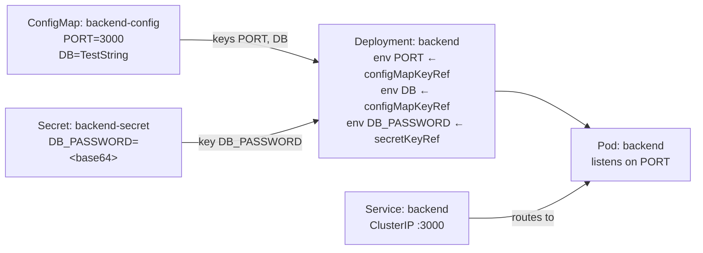

# ConfigMap + Secret → PORT (Express backend)

A tiny example showing how a **ConfigMap** and a **Secret** feed values into a Pod. The ConfigMap holds `PORT` and `DB`, the Secret holds `DB_PASSWORD`, the Deployment imports them as env vars, and the Express backend reads `process.env.PORT` and listens on it.



## Files

| File / Folder                       | Purpose                                                        |
| ----------------------------------- | -------------------------------------------------------------- |
| `configmap.yaml`                    | ConfigMap `backend-config` with `PORT: "3000"` and `DB`        |
| `secret.yaml`                       | Secret `backend-secret` with base64 `DB_PASSWORD`              |
| `backend/server.js`                 | Express app — reads `PORT`, logs it, listens on it             |
| `backend/{package.json,Dockerfile}` | Backend image (`node:20-alpine`)                               |
| `backend.yaml`                      | Deployment — imports `PORT`/`DB` via `configMapKeyRef` and `DB_PASSWORD` via `secretKeyRef` |
| `service.yaml`                      | ClusterIP Service on port 3000                                 |

## Run

```bash
cd basics/configmap-secret-port

# 1. Build + load the image
docker build -t configmap-port-backend:2.0 backend
kind load docker-image configmap-port-backend:2.0 --name my-cluster

# 2. Create the ConfigMap + Secret, then the Deployment and Service
kubectl apply -f configmap.yaml
kubectl apply -f secret.yaml
kubectl apply -f backend.yaml
kubectl apply -f service.yaml

# 3. Wait until it is ready
kubectl get pods -l app=backend -w

# 4. Reach it
kubectl port-forward svc/backend 8080:3000
```

Then open <http://localhost:8080> — it prints the port the backend is listening on. <http://localhost:8080/port> returns it as JSON.

## Verify PORT came from the ConfigMap

```bash
kubectl logs -l app=backend
# PORT = 3000 (imported from the backend-config ConfigMap)
# DB = TestString (imported from the backend-config ConfigMap)
# DB_PASSWORD = s*** (len 14) (imported from the backend-secret Secret)
# listening on port 3000

kubectl describe configmap backend-config
# Data
# ====
# PORT:  3000
# DB:    TestString
```

## Verify DB_PASSWORD came from the Secret

```bash
kubectl get secret backend-secret -o jsonpath='{.data.DB_PASSWORD}' | base64 -d
# s3cr3t-db-p@ss
```

Note that `kubectl describe secret` shows only the key names and byte sizes, never the values — `describe configmap` prints values, `describe secret` does not.

## Change the port

Edit `PORT` in the ConfigMap, re-apply, and restart the Pod (env vars are only read at container start):

```bash
kubectl patch configmap backend-config --type merge -p '{"data":{"PORT":"4000"}}'
kubectl rollout restart deployment/backend
```

If you change `PORT`, also update the Service `targetPort` (and the Deployment `containerPort`) to the same number, otherwise the Service points at the wrong port.

## Notes

- **One key vs. all keys:** `valueFrom.configMapKeyRef` imports a **single** key (`PORT`). `envFrom.configMapRef` would import **every** key in the ConfigMap as an env var.
- **Values are strings:** the ConfigMap stores `"3000"` as text; the app converts it with `Number(port)`.
- **Env vars are fixed at start:** changing the ConfigMap does not update a running Pod — restart it (`kubectl rollout restart`).
- **`containerPort` / `targetPort` are not automatic:** they must match the port the app actually listens on.
- **Missing key = crash:** if `PORT` isn't set, the app exits, and the Pod goes into `CrashLoopBackOff` — a quick way to see the dependency.
- **Secrets are base64, not encrypted:** `data` values are only encoded, so anyone with read access to the Secret (or the manifest) can decode them. Use RBAC and encryption-at-rest for real secrets, not base64.
- **`secretKeyRef` vs. `envFrom.secretRef`:** `valueFrom.secretKeyRef` imports a **single** key (`DB_PASSWORD`); `envFrom.secretRef` would import **every** key in the Secret.
- **`stringData` alternative:** you can write plaintext under `stringData` instead of `data` and Kubernetes base64-encodes it for you; `stringData` is write-only and is merged into `data`.

## Teardown

```bash
kubectl delete -f service.yaml -f backend.yaml -f secret.yaml -f configmap.yaml
```
