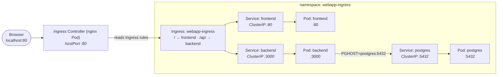

# Webapp: frontend + backend + postgres behind an Ingress

Same app as `../webapp-nginx-routing`, but routing is done by an **Ingress** instead of a hand-written NGINX config. The **NGINX Ingress Controller** (installed separately) reads the `Ingress` object and proxies traffic.



The difference from the nginx example: there you write the `nginx.conf` yourself; here you declare **routing rules** and the controller does the rest.

## Files

| File / Folder | Purpose |
| ------ | --------- |
| `kind-config.yaml` | Kind config — mapping host :80/:443 and labeling the node `ingress-ready` |
| `namespace.yaml` | The `webapp-ingress` namespace |
| `postgres.yaml` | Postgres Deployment + ClusterIP Service |
| `backend/server.js` | Express API — `/api/items`, `/healthz`; seeds the DB on startup |
| `backend/{package.json,Dockerfile}` | Backend image (`node:20-alpine`) |
| `backend.yaml` | Backend Deployment + ClusterIP Service |
| `frontend.yaml` | Frontend page (ConfigMap) + Deployment + ClusterIP Service |
| `ingress.yaml` | The Ingress — `/` → frontend, `/api` → backend |

## Run

```bash
cd basics/webapp-ingress

# 1. Create an ingress-ready cluster (maps host :80/:443; delete any existing first)
kind create cluster --name my-cluster --config kind-config.yaml

# 2. Install the NGINX Ingress Controller
kubectl apply -f https://raw.githubusercontent.com/kubernetes/ingress-nginx/main/deploy/static/provider/kind/deploy.yaml
kubectl wait --namespace ingress-nginx \
  --for=condition=ready pod \
  --selector=app.kubernetes.io/component=controller \
  --timeout=120s

# 3. Build + load the backend image
docker build -t webapp-backend:1.0 backend
kind load docker-image webapp-backend:1.0 --name my-cluster

# 4. Deploy the app
kubectl apply -f namespace.yaml
kubectl apply -f postgres.yaml
kubectl apply -f backend.yaml
kubectl apply -f frontend.yaml
kubectl apply -f ingress.yaml

# 5. Wait until ready
kubectl get pods -n webapp-ingress -w
```

Then open <http://localhost> — the page shows the items, fetched from the backend through the Ingress.

- <http://localhost/api/items> — the raw JSON from the backend

## Notes

- **Why the custom `kind-config.yaml`:** the controller binds hostPorts 80/443 on the node; `extraPortMappings` publishes those to your Mac, so it's reachable at `localhost`. That mapping can only be set at cluster-creation time.
- **The controller is separate:** `ingress-nginx` lives in its own namespace and is installed from the upstream manifest (not part of this folder).
- **Ingress routes to Services**, never directly to Pods; `postgres` is ClusterIP-only and never exposed.
- **Seeding / ephemeral data / credentials:** same as the other example — the backend seeds on startup, Postgres uses no volume, creds are plain env values (demo only).
- **First-boot 503:** you may briefly get `503` on `/` right after deploy — the controller reloads once the frontend Pod has endpoints. Retry after a few seconds.

## Teardown

```bash
kubectl delete namespace webapp-ingress
```
