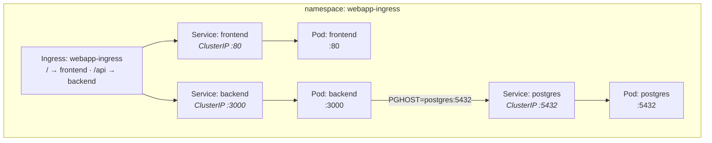
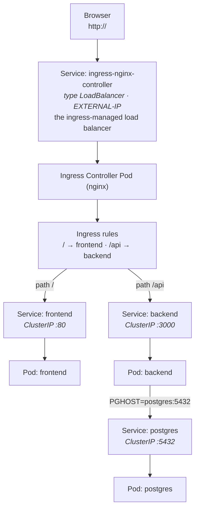

# Webapp: frontend + backend + postgres behind an Ingress

Same app as `../webapp-nginx-routing`, but routing is done by an **Ingress** instead of a hand-written NGINX config.

An **Ingress** is only a set of declarative routing rules (host/path → Service). It does not receive packets and does not run as a process. A separate **Ingress Controller** — here NGINX, running as a Pod — watches `Ingress` objects and actually proxies the traffic.

## App routing



The Ingress routes to **Services** (ClusterIP), never directly to Pods. `postgres` stays internal and is **not** exposed through the Ingress.

How traffic reaches the Ingress depends on the environment:

- **Local Kind on macOS** (no load-balancer provisioner): Docker port mapping → control-plane node → controller Pod. See **[WITHOUT-LOADBALANCER.md](./WITHOUT-LOADBALANCER.md)**.
- **Cloud, or a local cluster with a working LoadBalancer:** the controller's `LoadBalancer` Service gets an `EXTERNAL-IP` (the ingress-managed load balancer) → controller Pod. See "If you have a real LoadBalancer" below.

## Files

| File / Folder                       | Purpose                                                                                     |
| ----------------------------------- | ------------------------------------------------------------------------------------------- |
| `kind-config.yaml`                  | Kind config — maps host :80/:443 to the control-plane node and labels it `ingress-ready`     |
| `namespace.yaml`                    | The `webapp-ingress` namespace                                                              |
| `postgres.yaml`                     | Postgres Deployment + ClusterIP Service                                                     |
| `backend/server.js`                 | Express API — `/api/items`, `/healthz`; seeds the DB on startup                             |
| `backend/{package.json,Dockerfile}` | Backend image (`node:20-alpine`)                                                            |
| `backend.yaml`                      | Backend Deployment + ClusterIP Service                                                      |
| `frontend.yaml`                     | Frontend page (ConfigMap) + Deployment + ClusterIP Service                                  |
| `ingress.yaml`                      | The Ingress — `/` → frontend, `/api` → backend                                              |

## Run

```bash
cd basics/webapp-ingress

# 1. Create the Kind cluster (maps host :80/:443 on the control-plane; delete any existing first)
kind create cluster --name my-cluster --config kind-config.yaml

# 2. Install the NGINX Ingress Controller
kubectl apply -f https://raw.githubusercontent.com/kubernetes/ingress-nginx/main/deploy/static/provider/kind/deploy.yaml
kubectl wait --namespace ingress-nginx \
  --for=condition=ready pod \
  --selector=app.kubernetes.io/component=controller \
  --timeout=120s

# This setup reaches the controller through the control-plane node's port 80, so the
# controller Pod must run on that node. The upstream Kind manifest only selects
# kubernetes.io/os=linux, so add a nodeSelector for the ingress-ready label that
# kind-config.yaml puts on the control-plane.
kubectl patch deployment ingress-nginx-controller -n ingress-nginx --type merge \
  -p '{"spec":{"template":{"spec":{"nodeSelector":{"ingress-ready":"true"}}}}}'
kubectl rollout status deployment/ingress-nginx-controller -n ingress-nginx

# 3. Build + load the backend image
docker build -t webapp-backend:1.0 backend
kind load docker-image webapp-backend:1.0 --name my-cluster

# 4. Deploy the app
kubectl apply -f namespace.yaml
kubectl apply -f postgres.yaml
kubectl apply -f backend.yaml
kubectl apply -f frontend.yaml
kubectl apply -f ingress.yaml

# 5. Wait until ready
kubectl get pods -n webapp-ingress -w
```

Then open <http://localhost> — the page shows the items, fetched from the backend through the Ingress.

- <http://localhost/api/items> — the raw JSON from the backend

## If you have a real LoadBalancer (cloud or MetalLB)

When the environment provides a LoadBalancer implementation (a cloud provider, or MetalLB locally), the controller's Service — `ingress-nginx-controller`, type `LoadBalancer` — gets an external IP. **That Service *is* the ingress-managed load balancer.** It's "external" only in the sense that the actual load balancer is provisioned **outside** the cluster; in Kubernetes you address it through this Service's `EXTERNAL-IP`.



The LoadBalancer forwards to the controller — commonly through the Service's node ports, or directly to endpoints; the exact path depends on the provider, controller, and Service configuration. It does **not** normally inspect URL paths to pick `frontend` vs `backend`; that is the **controller's** job.

**What to change for this setup:**

- `kind-config.yaml`: remove `extraPortMappings` and the `ingress-ready` label — they only exist for the local Kind entry point.
- Install step: drop the `nodeSelector` patch.
- The app manifests and the `Ingress` stay exactly the same.

**Get its IP and visit it:**

```bash
kubectl get svc -n ingress-nginx ingress-nginx-controller
# or just the IP:
kubectl get svc -n ingress-nginx ingress-nginx-controller -o jsonpath='{.status.loadBalancer.ingress[0].ip}'

curl http://<EXTERNAL-IP>/            # → frontend
curl http://<EXTERNAL-IP>/api/items   # → backend JSON
```

|                       | Local Kind (no LB)                          | Real LoadBalancer                        |
| --------------------- | ------------------------------------------- | ---------------------------------------- |
| `kind-config.yaml`    | `extraPortMappings` + `ingress-ready` label | plain cluster                            |
| Controller install    | + `nodeSelector` patch (pin to a node)      | plain install                            |
| Reach the Ingress     | `http://localhost` (node `hostPort`)        | `http://<EXTERNAL-IP>`                   |
| Service `EXTERNAL-IP` | `<pending>`                                 | a real IP                                |

## Notes

- **Ingress vs. controller:** an `Ingress` declares rules; it does not receive packets. The **Ingress Controller** is a Pod that implements those rules.
- **Kind-specific networking:** `extraPortMappings`, the controller's `hostPort`, and pinning the controller to a node are specific to this local Kind arrangement. They are **not** required for every Ingress Controller installation.
- **`ingress-ready=true`:** a scheduling label placed on the control-plane node at cluster creation. It does not make a node ingress-ready or install a controller; the install patch uses it in the controller's `nodeSelector`.
- **`LoadBalancer` Service:** the controller's Service is type `LoadBalancer` — the ingress-managed load balancer. Here `EXTERNAL-IP` stays `<pending>` (no provisioner), so it is **not** the public entry point; traffic enters through the node's `hostPort`.
- **Workers:** in this config, ports are mapped only on the control-plane, so the controller must run there. Other arrangements (a LoadBalancer, a NodePort Service, or mappings on other nodes) may allow it to run on any suitable node.
- **The controller is a Pod:** it can run on any suitable node when the network entry point and scheduling configuration support that arrangement.
- **Postgres is internal:** it is ClusterIP-only and never exposed through the Ingress.
- **Seeding / ephemeral data / credentials:** same as the other example — the backend seeds on startup, Postgres uses no volume, creds are plain env values (demo only).
- **First-boot 503:** you may briefly get `503` on `/` right after deploy — the controller reloads once the frontend Pod has endpoints. Retry after a few seconds.

## Teardown

```bash
kubectl delete namespace webapp-ingress
```
