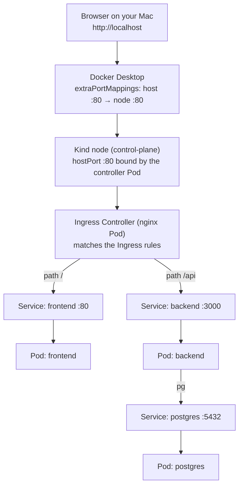
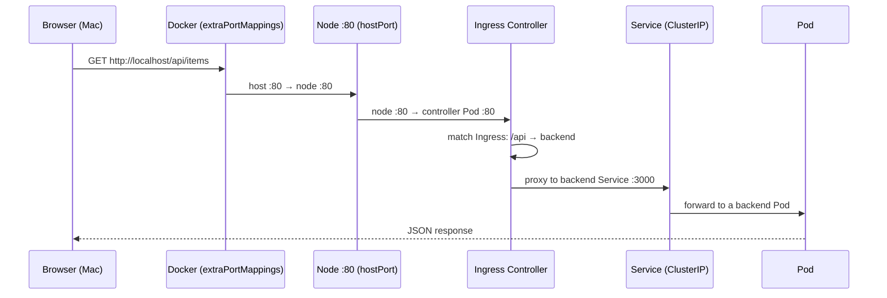
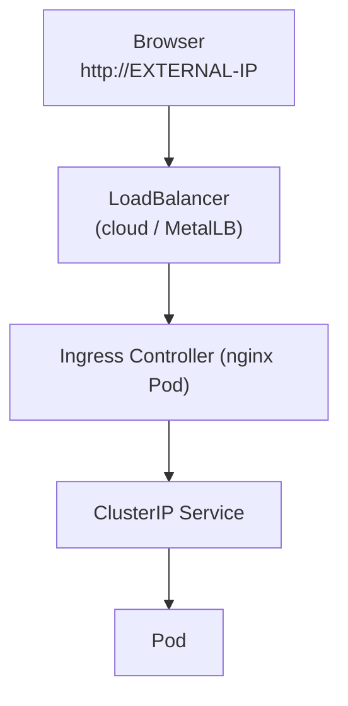

# How the Ingress works without a LoadBalancer (Kind)

On a real cluster you reach the Ingress through a `LoadBalancer` that has an external IP. A local Kind cluster has **no load-balancer provisioner**, so that Service stays `<pending>` and is never in the traffic path. Here's what actually happens instead.

## The path



Notice the `LoadBalancer` Service is **not** in that chain. Traffic enters through the **node's hostPort**, not through an external IP.

## One request, hop by hop



## The pieces (and what each one does)

| Piece | What it does |
| --- | --- |
| **`extraPortMappings`** | Docker publishes a port on the node container to your Mac (`host :80 → node :80`). Set only when the cluster is created. |
| **`hostPort`** | The controller Pod binds port 80 **on its node**. So the node's port 80 goes straight to that Pod. |
| **Ingress Controller** | The nginx Pod that reads `Ingress` objects and proxies the request. |
| **`Ingress` object** | Just the rules: `/` → `frontend`, `/api` → `backend`. |
| **ClusterIP Services** | Normal internal Services; the controller routes to these. |
| **`LoadBalancer` Service** | Exists, but `EXTERNAL-IP: <pending>` — **unused** here. |

## Why the controller must run on the **control-plane**, not a worker

Your Mac only ever reaches **one** node: the **control-plane**, because that's where `extraPortMappings` publishes `host :80 → node :80`. The **worker nodes have no port mapping**, so they aren't reachable from your Mac at all.

So if the controller Pod lands on a **worker**, this happens:

- your browser hits the **control-plane's** port 80,
- but nothing there is listening (the controller is on the worker),
- → connection refused (`curl` shows `000`).

That's exactly what happened during testing: the controller drifted from the control-plane to `my-cluster-worker`, and `http://localhost` broke until it was pinned back.

That's why the install step pins it:

```bash
kubectl patch deployment ingress-nginx-controller -n ingress-nginx --type merge \
  -p '{"spec":{"template":{"spec":{"nodeSelector":{"ingress-ready":"true"}}}}}'
```

## With a LoadBalancer (for contrast)



With a real LB you skip all of the Kind plumbing: no `extraPortMappings`, no `hostPort`, no node pinning. You just point at the LB's external IP, and the LB forwards to the controller.
