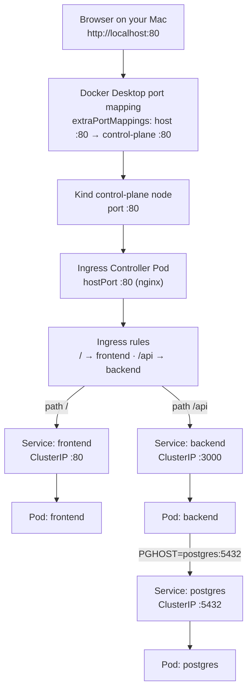
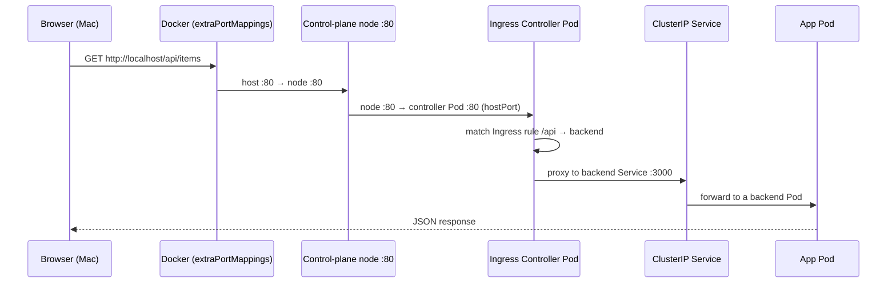
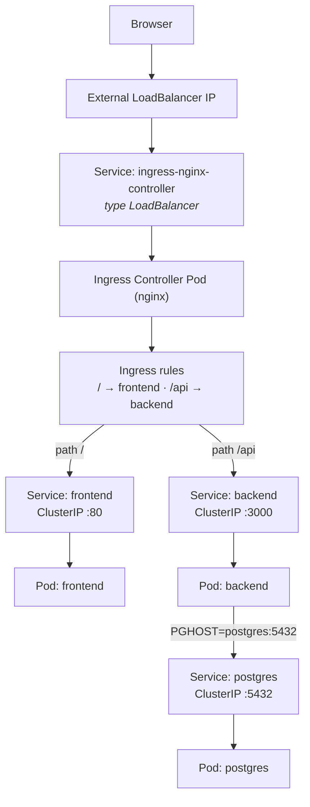

# How the Ingress is reached without a LoadBalancer (local Kind on macOS)

A local Kind cluster has **no load-balancer provisioner**, so the controller's `LoadBalancer` Service never gets an external IP (`EXTERNAL-IP: <pending>`) and is **not** the public entry point. Instead, this setup uses a Docker port mapping into the control-plane node.

> This page covers the **local Kind** path. For the cloud / working-LoadBalancer path, see the "If you have a real LoadBalancer" section in [README.md](./README.md).

## The path



The `LoadBalancer` Service is **not** in this chain. `postgres` is internal only — it is never exposed through the Ingress.

## One request, hop by hop



## What each piece is

| Piece | What it is / does |
| --- | --- |
| **`extraPortMappings`** | Docker publishes `host :80/:443` to the **control-plane node container**. Set only when the cluster is created (`kind-config.yaml`). |
| **`hostPort`** | The controller Pod binds port 80/443 on whichever node it runs on. |
| **`ingress-ready=true`** | A **scheduling label** we put on the control-plane node. It does not install anything or make a node "ingress-ready" by itself. The install step uses it in the controller's `nodeSelector`. |
| **Ingress Controller** | A Pod (NGINX) that watches `Ingress` objects and proxies requests. |
| **`Ingress` object** | Declarative rules (host/path → Service). It does **not** receive packets itself; the controller implements the rules. |
| **ClusterIP Services** | Normal internal Services; the controller routes to these. |
| **`LoadBalancer` Service** | The controller's Service is type `LoadBalancer`, but here `EXTERNAL-IP` stays `<pending>`, so it is **not** the entry point. |

## Why the controller runs on the control-plane (in this setup)

In this `kind-config.yaml`, `extraPortMappings` maps ports **only on the control-plane node**. So your Mac's `localhost:80` arrives at the **control-plane's** port 80. The controller binds `hostPort: 80`, so it must run on that same node for the port to lead to it.

If the controller lands on a **worker** instead, the control-plane's port 80 has nothing behind it → the browser gets a connection failure.

This is specific to **this** arrangement. The controller is a normal Pod and can run on **any suitable node** when the network entry point and scheduling allow it (for example with a LoadBalancer, a NodePort Service, or port mappings on other nodes).

That's why the install step pins it:

```bash
kubectl patch deployment ingress-nginx-controller -n ingress-nginx --type merge \
  -p '{"spec":{"template":{"spec":{"nodeSelector":{"ingress-ready":"true"}}}}}'
```

## About the `ingress-ready=true` label

- We add it to the control-plane node at cluster creation (`kind-config.yaml` → `kubeadmConfigPatches` → `node-labels`).
- It is **only a label**. It does not make a node ingress-ready and does not install a controller.
- The install step patches the controller Deployment to select it (`nodeSelector: ingress-ready=true`), so the scheduler places the controller on that node. The upstream Kind manifest does not reference this label on its own — the patch adds it.

## With a LoadBalancer (for contrast)



The LoadBalancer forwards to the controller (commonly through the Service's node ports, or directly to endpoints — the exact path depends on the provider, controller, and Service configuration). It does **not** normally inspect URL paths; the controller does the host/path routing.

With a working LoadBalancer you can drop the Kind-specific plumbing (`extraPortMappings`, `hostPort`, node pinning). See [README.md](./README.md) for those steps.
