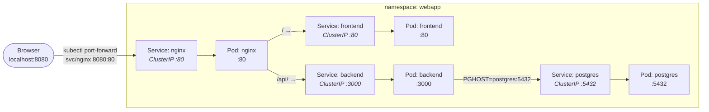

# Webapp: frontend + backend + postgres behind NGINX

A minimal 4-tier example. **NGINX is the single entry point**, then routes to the frontend and backend; the backend talks to Postgres. Everything runs in the cluster and is exposed only via **ClusterIP** Services — you reach it through `kubectl port-forward`.



No Ingress is used — NGINX is just a reverse proxy whose config lives in a ConfigMap.

## Files

| File | Purpose |
| ------ | --------- |
| `namespace.yaml` | The `webapp` namespace |
| `postgres.yaml` | Postgres Deployment + ClusterIP Service |
| `backend/server.js` | Express API — `/api/items`, `/healthz`; seeds the DB on startup |
| `backend/{package.json,Dockerfile}` | Backend image (`node:20-alpine`) |
| `backend.yaml` | Backend Deployment + ClusterIP Service |
| `frontend.yaml` | Frontend page (ConfigMap) + Deployment + ClusterIP Service |
| `nginx.yaml` | NGINX config (ConfigMap) + Deployment + ClusterIP Service |

## Getting the backend image into the cluster

Only the **backend** needs a custom image (frontend, nginx, and postgres use stock images). `docker build` stores it in Docker Desktop; the Kind nodes have their own containerd, so it must be loaded or pushed:

**Path A — load it onto the nodes (best for local dev):**

```bash
docker build -t webapp-backend:1.0 backend
kind load docker-image webapp-backend:1.0 --name my-cluster
```

**Path B — push to a registry and let the nodes pull:**

```bash
docker build -t <registry>/webapp-backend:1.0 backend
docker push <registry>/webapp-backend:1.0
# then edit backend.yaml: image: <registry>/webapp-backend:1.0
# (and set imagePullPolicy: Always if using the :latest tag)
```

## Run

```bash
cd basics/webapp

# 1. Build + load the backend image (see above)
docker build -t webapp-backend:1.0 backend
kind load docker-image webapp-backend:1.0 --name my-cluster

# 2. Deploy
kubectl apply -f namespace.yaml
kubectl apply -f postgres.yaml
kubectl apply -f backend.yaml
kubectl apply -f frontend.yaml
kubectl apply -f nginx.yaml

# 3. Wait until everything is Ready
kubectl get pods -n webapp -w

# 4. Port-forward NGINX to your machine
kubectl port-forward -n webapp svc/nginx 8080:80
```

Then open <http://localhost:8080> — the page shows the items, fetched from the backend through NGINX.

- <http://localhost:8080/api/items> — the raw JSON from the backend

## Notes

- **One entry point:** only `nginx` is port-forwarded; `frontend`, `backend`, and `postgres` are reachable only in-cluster (ClusterIP).
- **Names, not IPs:** each hop uses a Service name resolved by cluster DNS — NGINX is in `webapp`, so `backend`/`frontend` are the short names (`backend.webapp.svc.cluster.local`).
- **Seeding:** the backend creates the `items` table and inserts the sample rows on startup, only if the table is empty.
- **Ephemeral data:** Postgres uses no volume, so data resets if its Pod is recreated; the backend re-seeds on the next start.
- **Credentials** are plain env values in the manifests — fine for a local demo, not for anything real.
- **After editing the backend:** rebuild, reload (Path A), restart:
  ```bash
  docker build -t webapp-backend:1.0 backend
  kind load docker-image webapp-backend:1.0 --name my-cluster
  kubectl rollout restart deployment/backend -n webapp
  ```

## Teardown

```bash
kubectl delete namespace webapp
```
